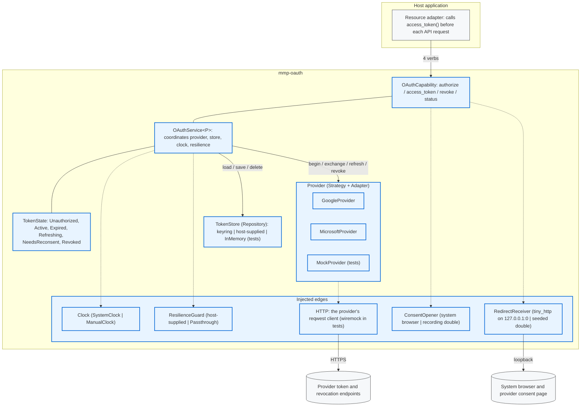

# MMP.OAuth architecture

This document describes the design of the `mmp-oauth` crate and its two companion crates, `mmp-secret` and `mmp-quota`.

## 1. Goal

`mmp-oauth` turns a user's consent into a live access token that refreshes itself. A host application calls four verbs. The provider, the token store, the clock, the browser and the loopback listener are injected traits, so the whole OAuth flow runs in tests with a mock provider and no network.

## 2. Why a separate library

All OAuth code lives in one crate. That gives four properties:

1. **One place to review.** A security reviewer reads one crate for token handling, scope requests, and storage.
2. **A clear trust boundary.** The crate has three external edges: provider HTTP, the token store, and the loopback listener. Tokens leave the crate only through the `AccessGrant` value and the `TokenStore` trait.
3. **Reuse.** Any desktop application gets the same flow by depending on the crate.
4. **No server.** The crate implements the public-client flow for native apps (RFC 8252). It needs no backend, and it has no code path that sends a token to one.

## 3. Where the crate sits

The host application owns the resource. It asks `mmp-oauth` for a token and then calls the provider's API (Gmail, Drive, Microsoft Graph, or another resource) itself. The boundary is one value type, `AccessGrant`, that crosses one call.

The library ends at the access token. Resource base URLs and API calls belong to the host. A new resource is a new set of scope strings, with no change to this crate.

## 4. Shape

The host names no token endpoint, no keystore, and no flow. A new provider is a new `Provider` implementation and profile. A new storage backend is a new `TokenStore` implementation. Neither change touches the facade or the host.

## 5. Pattern map

| Concern | Pattern | Artifact | Why it fits |
|---|---|---|---|
| Four-verb entry point over the subsystem | Facade | `OAuthCapability`, `OAuthService` | It coordinates provider, store, clock and resilience. It holds no provider logic. |
| One provider's flow and endpoints behind one trait | Strategy | `Provider` trait | The service runs authorize, refresh and revoke without knowing which provider answers. |
| Translate the verbs to a provider's wire format and quirks | Adapter | `GoogleProvider`, `MicrosoftProvider` | Each maps the verbs to its provider's endpoints and rules (for example the `127.0.0.1` redirect host). |
| Pick the provider from a stable kind | Factory Method | `ProviderKind` (host-side selection) | One lookup instead of branches across the code. |
| Assemble configuration step by step | Builder | `OAuthService::with_*`, `ProviderProfile::google`, `ProviderProfile::microsoft` | The configuration is four optional injections. `with_*` methods read better than positional arguments. |
| Token lifecycle as a named state | State | `TokenState` | Behaviour keys on one named state, not on several boolean flags. |
| Token persistence behind a swappable backend | Repository | `TokenStore` | Keyring, a host store, or in-memory, with no facade change. |
| Retry and circuit breaking on network calls | Circuit Breaker, Retry | `ResilienceGuard` seam | The guard wraps the semantic operation (`refresh`, `exchange`), where the error classifier (`invalid_grant` is permanent) has meaning. |
| Tell the host that a token refreshed | Observer | `RefreshObserver` | One closure the host wires to a UI or an audit log. The default does nothing. |

## 6. Test seams

The flow is deterministic because each external edge is a trait with a test double:

| Edge | Trait | Production implementation (feature) | Test implementation |
|---|---|---|---|
| HTTP | the provider's own `reqwest` client (`reqwest-transport`); `HttpTransport` is defined for a later injection seam | the same client pointed at a `wiremock` server |
| Clock | `Clock` | `SystemClock` | `ManualClock` |
| Browser opener | `ConsentOpener` | system browser (`loopback-flow`) | recording double |
| Loopback listener | `RedirectReceiver` | `tiny_http` on `127.0.0.1:0` (`loopback-flow`) | seeded double |

The CSRF guard is a type-state. `AuthSession::validate_redirect` is the only way to get a `PendingExchange`, and it rejects a mismatched `state` parameter. Code cannot call `exchange_code` without proof that the state matched, so the compiler enforces the most important correctness property of desktop OAuth. `tests/dance.rs` tests the valid path and the attack path.

## 7. Rejected designs

1. **Adopt `yup-oauth2`.** Rejected. Its abstractions are Google-shaped, and its disk token cache competes with the host's `TokenStore`. Two auth models behind one facade is worse than one.
2. **One struct per state (`Box<dyn TokenState>`).** Rejected. The transitions are few and the behaviour differences are small. An enum gives the named state without five structs.
3. **A separate Builder type for `OAuthService`.** Rejected at four optional injections. Promote it if the configuration grows past about six options.
4. **Name tokio in the trait signatures.** Rejected. The traits name no runtime. `async_trait` keeps them object-safe, and tokio appears only in the feature-gated production implementations. The flow runs at human speed, so the allocation per call does not matter.
5. **Ship a retry and backoff implementation.** Rejected. The host already has a resilience policy. The crate defines the `ResilienceGuard` trait and defaults to `Passthrough`.
6. **A server-side token broker.** Rejected. A broker would hold every user's refresh token on a server. The crate supports only the public-client, PKCE, loopback flow that RFC 8252 recommends for native apps.

## 8. Out of scope

1. OpenID Connect and ID-token verification. The crate authorizes API access. It does not prove identity.
2. The device-code flow. The `Provider` trait can gain it as an additive method later.
3. A C ABI. Rust hosts use the trait objects directly.
4. A shared abstraction for provider quirks beyond `ProviderProfile`. Two providers do not justify one.

## 9. Design decisions

1. **`Secret` lives in a separate leaf crate, `mmp-secret`.** Any crate that holds a credential can depend on it without depending on `mmp-oauth`. `mmp-oauth` re-exports it as `mmp_oauth::Secret`. `Secret` has a redacting `Debug`, zeroizes on drop, and has no serde implementation on purpose.
2. **One client id ships with the application.** A desktop app is a public client: it cannot keep a client secret (RFC 8252 section 8.5). The application registers one client id with each provider. Users then sign in with no setup of their own. `ProviderProfile::google` and `ProviderProfile::microsoft` take that client id from configuration.
3. **Resilience is a trait seam.** `mmp-oauth` defines `ResilienceGuard` and the host supplies the implementation. This keeps the crate free of a retry dependency.
4. **The crate is resource-agnostic.** It ends at the access token. Which API the host calls with that token is the host's choice. A new resource is a new `ScopeRequest` scope string.
